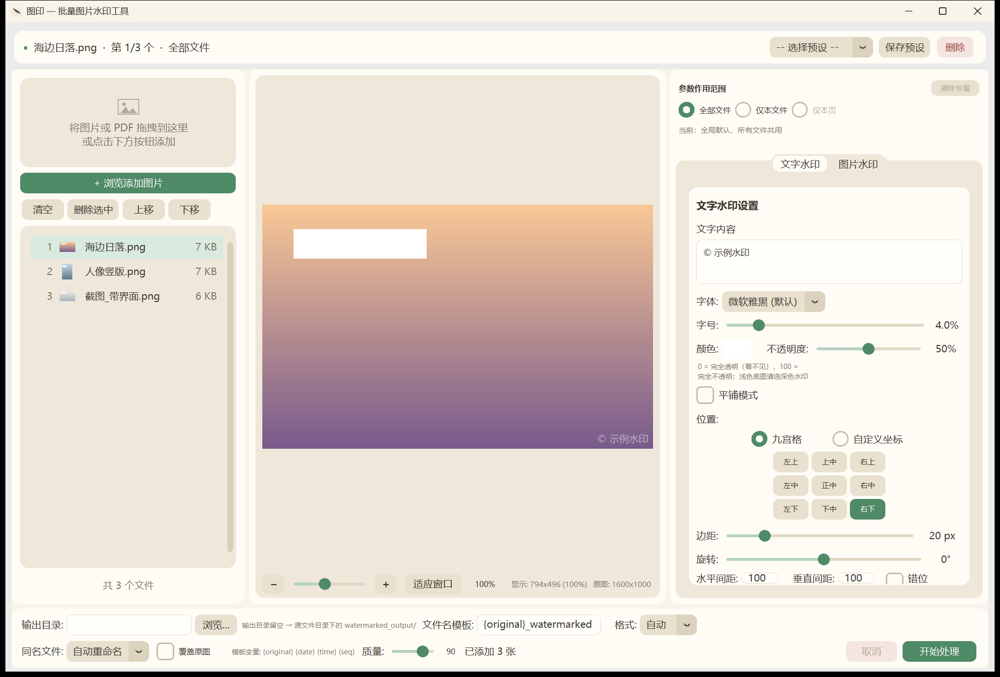

# 批量图片水印工具

> 基于 Python + Pillow 的桌面端批量水印处理工具，面向图片与 PDF 的版权保护与品牌标识场景。开箱即用，支持拖拽导入、批量处理、实时预览，可一键打包为 Windows 可执行文件。无需联网，无需登陆，素材导入导出均在设备本地进行，保障个人隐私及数据安全。

<!--
## 界面预览



如需在 README 显示界面截图：
1. 运行 `python main.py` 启动程序
2. 拖入一张测试图，设置水印参数做演示
3. 用截图工具截取界面，保存为 `assets/screenshot.png`
4. 删除上方 HTML 注释包裹的两行（`<!--` 和 `-->`），保存提交
-->

---

## 目录

- [功能亮点](#功能亮点)
- [支持格式](#支持格式)
- [快速开始](#快速开始)
- [从源码运行](#从源码运行)
- [打包为可执行文件](#打包为可执行文件)
- [许可证](#许可证)

---

## 功能亮点

### 1. 双水印模式，可叠加

支持**文字水印**与**图片 / Logo 水印**两种模式，可单独使用，也可同时叠加（先文字后图片）。

实际生效的类型由**内容**推导，而不是由「当前打开的是哪个 Tab」决定：

| 条件 | 实际类型 |
|------|----------|
| 文字非空 **且** 有 Logo | `both` |
| 只有 Logo | `image` |
| 其余 | `text` |

两个面板的参数会**合并成一份完整配置**提交，切换 Tab 只影响你正在编辑哪一组参数，不会把另一组静默关掉。所以「在文字 Tab 里调字号」不会丢掉已经选好的 Logo。

### 2. 文字水印完整参数

| 参数 | 说明 |
|------|------|
| 文本内容 | 支持多行（`\n` 换行） |
| 字体 | 自动探测系统字体，支持手动指定 |
| 字号 | 按图片短边的百分比自适应（1%–20%） |
| 颜色 | RGBA 四通道（颜色选择器取色） |
| 不透明度 | 0–100（0 = 完全看不见，100 = 完全不透明） |
| 位置 | 九宫格预设 或 自定义坐标百分比 |
| 旋转 | -180° ~ 180° |
| 平铺 | 整图平铺，支持行间错位；间距按「看得见的边缘」计算 |
| 边距 | 像素级边距 |

### 3. 图片 / Logo 水印

| 参数 | 说明 |
|------|------|
| Logo 来源 | 本地图片文件 |
| 缩放 | 按底图宽度比例（1%–50%），以 Logo 实际可见内容为准（自动裁掉透明留白） |
| 不透明度 | 0–100 |
| 旋转 | -180° ~ 180° |
| 平铺 | 支持整图平铺与交错排列 |
| 位置 | 九宫格 或 自定义坐标 |

### 4. 实时预览（真·所见即所得）

所有参数调整即时反映在预览区，无需反复试错。

**预览不是「大致像」，而是与导出严格同构**：同一套参数、同一套几何算法，只是在缩小的底图上渲染。这是靠把「绝对像素量」一起按比例换算做到的 ——

| 参数类别 | 字段 | 缩放行为 |
|----------|------|----------|
| 相对量 | 字号占比 `font_ratio`、Logo 占比 `scale_ratio` | 天然等比，任何分辨率都一致 |
| **绝对像素量** | 间距 `spacing_x/y`、边距 `margin`、`logo_margin`、`logo_spacing_x/y` | 按 `scale = 预览分辨率 / 导出分辨率` **同步换算** |

引擎的 `apply_watermark(img, cfg, scale=1.0)` 多了一个 `scale` 参数：`scale=1.0` 就是导出（行为与历史版本逐字节一致），预览传小于 1 的值。

字号与 Logo 的**下限也一起缩放**（`font_size = max(12*scale, 短边*font_ratio)`），否则小图上预览字号会被 12px 下限顶住，比导出的相对字号大出好几倍。

导出的「参考分辨率」只有一处来源：图片是原图像素，PDF 是页面可视尺寸 × `OVERLAY_SCALE`，由 `pdf_engine.overlay_reference_size()` 统一给出，避免覆盖层生成与预览两处算法各写一遍而逐渐漂移。

拖入 PDF 时预览区底部会出现**翻页栏**（上一页 / 下一页 / 跳转），可逐页检查水印效果；每页按自身页面尺寸渲染，混合尺寸或带 `/Rotate` 的页面都能正确显示。

**流畅度**：三类重复劳动各自带缓存 —— 解码后的底图按 `(路径, 页, 目标尺寸)` 缓存、渲染结果只在参数变化时重做、显示图按 `(画布尺寸, 缩放, 渲染版本)` 缓存。缩放与拖动只重采样已渲染好的图，不再重跑引擎；渲染走后台线程且做了**单飞合并**（渲染进行中只登记待办标记，不堆线程）。

### 5. 批量处理 + 拖拽导入

- 支持文件拖拽导入与文件对话框两种方式
- 自动去重、格式过滤
- 文件名模板支持变量：`{original}`、`{date}`、`{time}`、`{seq}`

### 6. 预设系统

水印配置可保存为 JSON 预设，支持版本迁移与 Logo 路径失效容错，常用参数一键复用。

### 7. PDF 文件水印

除图片外，同样支持给 **PDF 逐页加水印**。

| 参数 | 说明 |
|------|------|
| 处理方式 | 覆盖层合并（**非**把页面转成图片），原文内容保留、文字仍可选可搜 |
| 参数复用 | 文字 / Logo 的全部参数与图片完全一致，预览所见即所得 |
| 页数显示 | 预览区显示总页数与当前页尺寸，可上一页 / 下一页 / 跳到第 N 页逐页检查 |
| 尺寸适配 | 按各页原始页面尺寸生成覆盖层，混合页面尺寸的 PDF 同样正确 |
| 旋转页 | `/Rotate 90/180/270` 的页面按显示方向渲染并反向写回，水印不被拉伸 |
| 输出格式 | 强制输出为 `.pdf` |

### 8. 输入值安全校验

所有数值输入（坐标百分比、间距、透明度、缩放、旋转角度）在进入引擎前统一校验：越界值自动夹取到合法区间、非法值回退默认值，并在状态栏提示修正结果，不会静默产生错误水印。

### 9. 参数作用范围：不同文件、不同页可以用不同参数

右侧面板顶部选择当前这套参数记到哪一层：

| 作用范围 | 含义 |
|----------|------|
| 全部文件 | 作为**全局默认**，没单独设置过的文件/页都用它 |
| 仅本文件 | 只记给列表里选中的这个文件（列表行亮起「专属」） |
| 仅本页 | 只记给 PDF 当前预览页（翻页栏显示「专属页: 2, 5」） |

导出时按 **页 > 文件 > 全局** 逐层查找：

- **只记改动过的字段**：单独设置某文件后，没改过的字段仍跟随全局默认变化，不会被旧值冻住
- **自动定位**：选中带专属参数的文件/页时，作用范围自动跳到那一层，面板显示的就是该文件真正会用的参数
- **手动切回「全部文件」**编辑全局默认时，提示行会写明「本文件已有专属参数，当前修改不影响它」，避免误以为改了个寂寞
- 「清除专属」删除当前层的专属参数，该文件/页回落到上一层

### 10. 输出为 PDF

输出格式下拉新增 **PDF**：

| 选项 | 行为 |
|------|------|
| PDF（不勾选合并） | 每个输入产出一个 PDF：图片 → 单页 PDF（页面尺寸 = 像素 × 72/96，与图片同比例、不留白边）；PDF → 逐页加水印后输出 |
| PDF + 勾选「合并为单个 PDF」 | 整批按列表顺序合成**一个多页 PDF**（一图一页），默认文件名形如 `合并水印_20261012_174500.pdf`；中途取消不会留下半成品文件 |

每个输入都用**它自己那一层**的参数（文件层 / 页层），所以「A 打红字、B 打蓝字、C 的第 1 页不打」在合并输出里同样成立。

图片放进 PDF 时的编码按**是否存在真实透明像素**选择：有透明像素走无损 PNG（保住 alpha），完全不透明走 JPEG 并应用底部栏的质量设置。
注意判断依据是"真的有透明像素"而不是"有 alpha 通道" —— 加过水印的图片一律是 RGBA，只看通道会让质量设置彻底失效、体积还大得多。

---

## 支持格式

| 类型 | 输入扩展名 | 输出 |
|------|-----------|------|
| 图片 | `.jpg` `.jpeg` `.png` `.bmp` `.webp` `.tiff` `.tif` | 同输入格式，并支持 `auto` / `png` / `jpeg` / `pdf` 格式转换 |
| PDF | `.pdf` | 固定输出 `.pdf`（逐页叠加水印） |

PDF 与图片可混合拖入同一批次，各自按对应引擎处理；选择 `PDF` 输出时两者都可产出 PDF，也可整批合并成一个多页 PDF。

---

## 快速开始

### 方式一：使用打包好的 exe（推荐普通用户）

1. 从 [Releases](https://github.com/MilanDeShallo/Batch-Image-Watermarking-Tool/releases/latest) 下载 `WatermarkTool-vX.Y.zip` 并解压。
2. 运行 `批量图片水印工具.exe`（或在项目根目录双击 `打开水印工具.bat`）。
3. 拖入图片或 PDF，点击「添加文件」即可开始。

无需安装 Python 或任何依赖。解压后请保持 `WatermarkTool` 文件夹完整 —— exe 与同目录的 `_internal` 是一体的，单独把 exe 拷出来无法运行。

### 方式二：从源码运行

见下节。

---

## 从源码运行

### 环境要求

- Windows 10 / 11（已测试）
- Python 3.10 及以上

### 安装依赖

```bash
cd watermark_tool
pip install -r requirements.txt
```

依赖清单（`requirements.txt`）：

```
pillow>=12.3.0
customtkinter>=5.2.2
tkinterdnd2>=0.6.2
reportlab>=4.0.0      # PDF 覆盖层生成
pypdf>=4.0.0          # PDF 逐页合并
pypdfium2>=4.30.0     # PDF 预览渲染
pyinstaller>=6.21.0
```

> `pyinstaller` 仅打包时需要，运行时可省略。
> `reportlab` / `pypdf` / `pypdfium2` 仅为 PDF 功能所需；若只用图片水印，可不安装。

已验证版本组合：Pillow 12.3.0、customtkinter 6.0.0、tkinterdnd2 0.6.2、reportlab 5.0.1、pypdf 6.16.2、pypdfium2 5.13.0、PyInstaller 6.21.0（Python 3.14）。

### 启动

```bash
python main.py
```

或双击仓库中的 `启动水印工具.bat`。

---

## 打包为可执行文件

项目内置 PyInstaller 打包脚本，一键生成免环境运行的 exe。

### 一键打包

```bash
build_exe.bat
```

脚本会自动完成依赖检查、清理旧构建、打包、验证输出。

### 手动打包

```bash
python -m PyInstaller build.spec --noconfirm
```

### 输出

- 输出目录：`dist/WatermarkTool/`
- 主程序：`dist/WatermarkTool/批量图片水印工具.exe`
- 将整个 `WatermarkTool` 文件夹分发给用户即可

`build.spec` 已处理 CustomTkinter、tkinterdnd2 的数据文件收集、`presets` 目录打包，以及 PDF 所需的 `pypdfium2` 原生 DLL（`collect_dynamic_libs`）与 `reportlab` / `pypdf` 隐式导入，无需额外配置。

---


## 许可证

本项目采用 [MIT License](LICENSE)。

第三方依赖许可证：Pillow（MIT-CMU）、customtkinter（MIT）、tkinterdnd2（MIT）、reportlab（BSD）、pypdf（BSD）、pypdfium2（Apache-2.0 / BSD），均与本项目的 MIT 协议兼容。

如需更换许可协议，请修改本声明并添加对应 LICENSE 文件。
